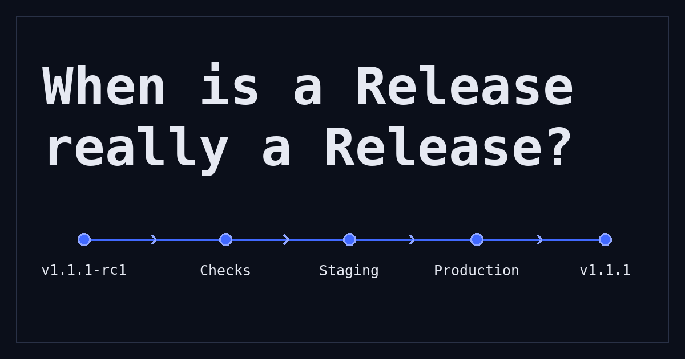
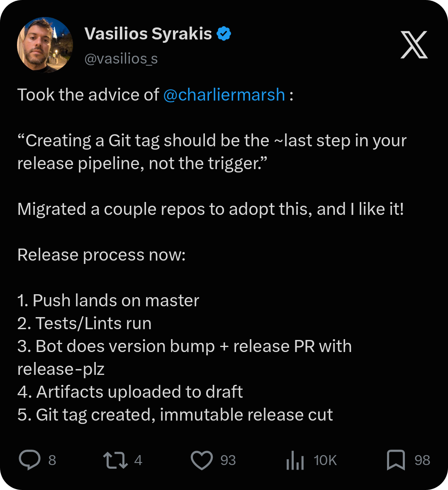
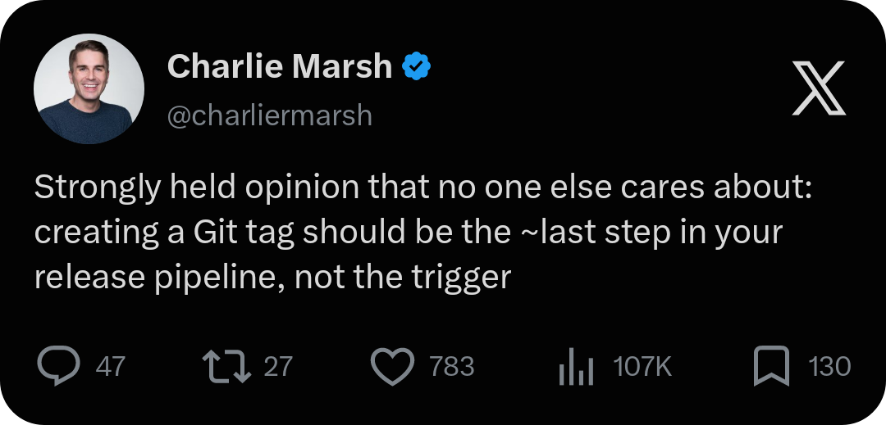
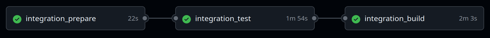
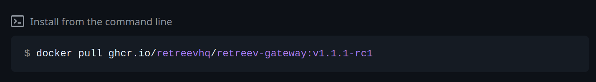
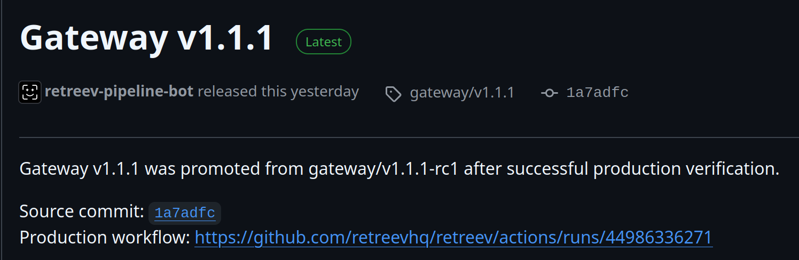

*Versioning applications, APIs, and packages makes their ongoing changes easier to track and manage.*

It made sense the first time I learned about it, especially since I had always worked without it and then realized its importance. Semantic versioning (SemVer) is the method I have since used in projects.



I typically use Git tags to trigger deployments.

```bash
$ git tag vision/v1.1.0
$ git push origin vision/v1.1.0
# GitHub Action picks this up and runs the pipeline
```

The resulting artifacts carry the tagged version, and then there's a release via a CI/CD pipeline. If all is green, then the job is done and we have a new version. If it's red, well, there's an inconvenient disruption:

- figure out what went wrong -- usually a failing test;
- fix the issue;
- delete the tag, locally and upstream;
- recreate the tag and push (fingers crossed).

This clearly isn't efficient, but *ehrr*... I got used to it, until I recently thought to do better after finding certain tweets.

| | |
| --- | --- |
|  |  |
| [<sub>Source</sub>](https://x.com/vasilios_s/status/2094086529450967327) | [<sub>Source</sub>](https://x.com/charliermarsh/status/2081537991592288337) |

Considering how I used to do it, creating a Git tag as approximately the last step in a pipeline, rather than as the trigger, seemed like a better way. I wouldn't have to repeat that "red" cycle. But if the trigger is "push lands on *master*/*main*", this, to me, only works if you're the only one on the project.

If there are more eyes [on main], what happens to changes that aren't up for a release? And there I was, looking for what a trigger should be.

**Enter release candidates**.

It's a concept I picked up from programming languages (and probably most major projects I know of), where they use release candidates for their versions, something like [Python 3.15.0rc2](https://www.python.org/downloads/release/python-3150rc2/).

> For context, my use case is application versioning and deployments targeted at VPS instances.

While I am not sure how *big projects* handle this, my idea was to use this concept to manage my versioning -- for [Retreev](https://retreev.app) microservices, for example:

- Use `-rc1` as the suffix for the release version and push:

  ```bash
  git tag gateway/v1.1.1-rc1 && git push origin gateway/v1.1.1-rc1
  ```

- The *integration* GHA workflow picks up this release candidate tag and runs the integration checks.

  

- If successful, the built Docker image is published to the container registry with the `-rc1` tag.

  

- Another GHA workflow is automatically triggered to deliver the release to the staging environment.

- After staging approval -- or direct promotion -- a workflow deploys the release candidate to production. If deployment succeeds, it applies the stable tag `gateway/v1.1.1` to the release.



If it's red at any point, the issue is fixed and the release candidate is advanced... `rc1` → `rc2`. This way:

- it is more feasible to test versions of the same release in staging;
- we avoid the rigmarole of ad-hoc resets when a deployment fails;
- if there's ever a need for a hotfix, the `-rc1` image can be used directly and easily differentiated as "temporary".

<ReleaseTrace />

This is my current update to my workflow for versioning and deployments to VPS instances. Like before, it is bound to change in the future if and when I learn to do better again.