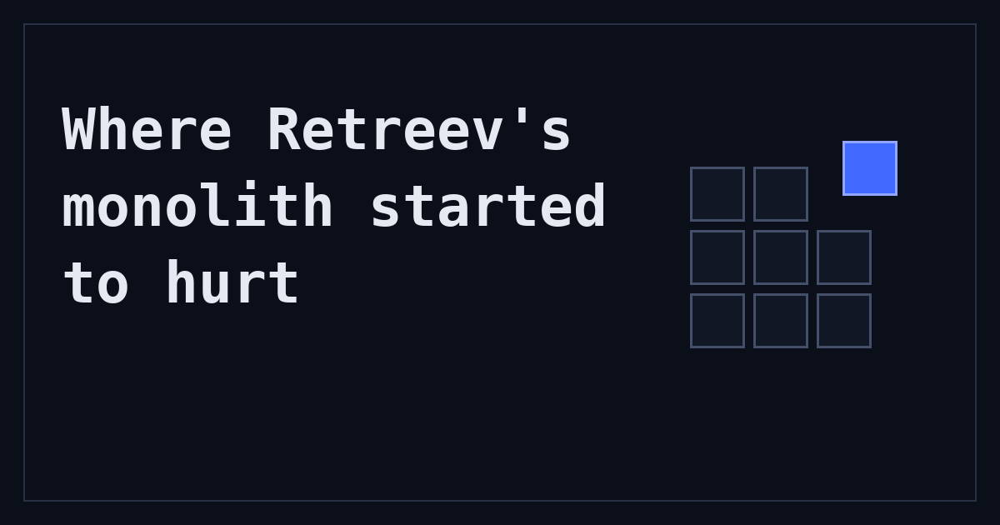
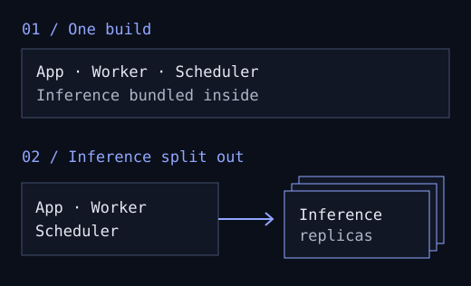
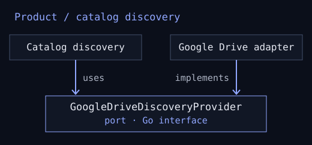

*Design is a process, and each iteration reflects the ideas and decisions made with the information available at that point in time.*

---

With 2,000+ users and counting, we could see that people liked the convenience of [Retreev](https://retreev.app). They kept coming back. Behind closed doors, though, we knew the system that got us this far couldn't take us to the next phase. Here's why we moved to microservices and what changed along the way.

What we set out to do in June was to make it ridiculously easy and fast to find the photos you're in. Simply that. Think about an event you've attended. Maybe you got a Google Drive link with 900+ photos from that day. Maybe you never got the link. It makes sense to make it more intuitive to enjoy those photos, like you would in your phone's gallery.

We started with a Python app, ML models and no UI. All the app gave us were numbers. The correlations we saw between them helped us realize *we could do this*. And so we shipped it -- with a UI later on, of course. Everything was synchronous, even the calls to our models, so that version wasn't much use in practice. Then came the modular monolith. We plugged in Celery to run background jobs as part of our event-driven architecture.

Modular monolith: same build but different startup commands for the main app, background worker and scheduler. Running the ML models inside that app became a problem. They changed less often than the rest of the app, and we wanted to run more replicas of just the inference pipeline. So we moved inference into its own app. It exposed a REST API at first; later we switched to gRPC.

We stuck with the modular monolith architecture for most of Retreev's growth, until we felt the growing pains in four areas: performance, scalability, reliability and maintainability.

We were so focused on shipping fast that we didn't give the system design enough attention and debt crept up on us. It showed in the API design, in how our "decoupled" systems talked to one another, and in the data models and algorithms we used. Even our median latency (*p50*) wasn't great in some cases, let alone *p99*. We ran on Docker Swarm, which gave us its own set of scaling problems. Failures would sometimes take us by surprise. 

We'd used an ORM, which had increasing friction as the complexity of data models increased. It was one more thing anyone working on Retreev had to learn. I also had not settled on a consistent way to structure the codebase, making it challenging to navigate with time, especially when working with agents.

I personally had had enough. And so we spent the last three months rebuilding everything from the ground up.

The first problem I wanted to solve was maintainability. I wanted a codebase that was easy to understand and contribute to, both for me and for anyone who might work on Retreev later. Go was a no-brainer for me:

- It favors composition and lets types satisfy interfaces implicitly. "Walks like a duck, must be a duck."
- It's statically typed and reduces gotchas.
- It compiles to a binary, making it more convenient to deploy and run.
- It has excellent tooling, documentation and a great ecosystem.

Go's approach to composition is beautiful, but I didn't want to leave the structure of each service up to whatever made sense that day. I borrowed the hexagonal pattern from *gRPC Microservices in Go*. In Product, for example, we keep the media catalog logic separate from the adapters we wrote for the database and Google Drive. That's a distinction we can carry from one service to the next, making things consistent.

For catalog discovery, we define what we need from Google Drive as a Go interface. That's the ***port***. The Drive adapter *implements* it, and we pass that ***adapter*** in when Product starts. That's all dependency injection amounts to here. If Google changes its API, just its adapter needs to be focused on, without affecting other parts of the system.

We chose microservices so we could isolate problems and tackle them one service at a time. Microservices come with their own challenges, but for us the trade-offs were worth it. A simplified look at the new system:

- **Gateway:** API and security
- **Identity:** authentication
- **Product:** media catalog
- **Vision:** inference
- **Worker:** background jobs
- **Search:** photo search
- **Drive:** our in-house storage alternative to Google Drive
- **Billing:** payments and subscriptions

Each service gets its own [versioning](https://theolujay.dev/articles/when-is-a-release-really-a-release), too.

As we built each service, new questions came up. One thing I had to think carefully about was contracts: OpenAPI between Gateway and the web client, Protobuf between services, and the SQL schemas for some of our databases. Those choices would affect how the system performed and how easily we could change it later.

Then there's how we deploy and orchestrate all these services, how we used ETL pipelines to move data from one database into three with very different designs, and how we wired up observability. But let's leave those stories for another day.
